# Citizen Assist AI: Documento de arquitetura

> **Fonte de verdade:** [`docs/especificacao/CITIZEN_ASSIST_SPEC.md`](especificacao/CITIZEN_ASSIST_SPEC.md) (a "spec"). Este documento **detalha** a arquitetura da spec §5 com diagramas, fluxos e contratos entre módulos. Ele não cria requisitos: se houver conflito, vale a spec, e a mudança deve ir primeiro para a spec (regra "spec primeiro").
>
> Marcações usadas: **(spec)** = decisão aprovada · **(sugestão)** = detalhe de implementação que pode mudar sem reunião · **(EM ABERTO)** = decisão humana pendente (spec §17).
>
> Os diagramas usam Mermaid, que o GitHub desenha automaticamente.

---

## 1. Princípios de arquitetura

| # | Princípio | Consequência no desenho | Spec |
|---|---|---|---|
| P1 | **A resposta vem da base, nunca do LLM** | O conteúdo da orientação sai sempre de `data/base.json`. O LLM só escolhe a ferramenta, transcreve voz e sugere o nome de documentos | §1 |
| P2 | **O núcleo roda sozinho** | `python src/sistema.py` funciona sem `pip install`, `.env` ou internet; bibliotecas da Onda 2 só são importadas em `--servidor` | §5.3 |
| P3 | **Privacidade por padrão** | Todo dado de usuário é filtrado por `user_id`; o núcleo não guarda dado pessoal; a senha do cofre nunca passa pelo chat | §10.1, §13 |
| P4 | **Falhar com elegância** | Entrada ruim nunca derruba o programa; falha do Gemini cai no fallback por regras; falha de um feed não derruba o briefing | §6.2, §9, §11 |
| P5 | **Peças trocáveis** | Armazenamento, LLM e feeds ficam atrás de interfaces pequenas, para serem trocados sem reescrever o resto | §5.2 |
| P6 | **Mensurável** | Busca determinística, com limiar e margem em constantes, permite calcular taxa de acerto e tempo | §7.3, §14 |

---

## 2. Visão de contexto

Quem e o que conversa com o sistema.

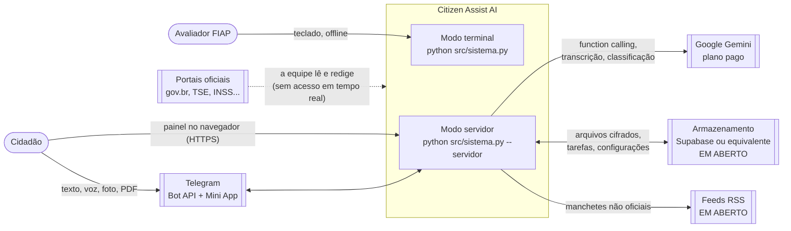

> Os portais oficiais **não são consultados pelo programa**. A equipe lê as páginas, redige a orientação e registra a data (spec §7.1). A consulta em tempo real está fora do escopo (roadmap).

---

## 3. Modos de execução

| Modo | Comando | Usa rede? | Precisa de `.env`? | Bibliotecas externas | Quem usa |
|---|---|---|---|---|---|
| Terminal (padrão) | `python src/sistema.py` | Não | Não | Nenhuma | Avaliador e demonstração |
| Avaliação | `python src/sistema.py --avaliar` | Não | Não | Nenhuma | Equipe (métricas da busca e rubrica A × B) |
| Validação de entrega | `python src/sistema.py --validar-entrega` | Não | Não | Nenhuma | Equipe, antes de entregar |
| Servidor | `python src/sistema.py --servidor` | Sim | Sim (só na VM) | aiogram, APScheduler, servidor web, cryptography, google-genai, feedparser | VM de produção |

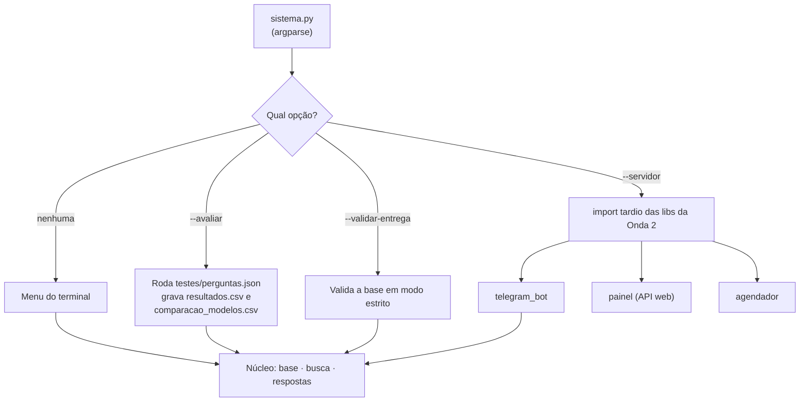

---

## 4. Módulos e dependências

### 4.1 Camadas

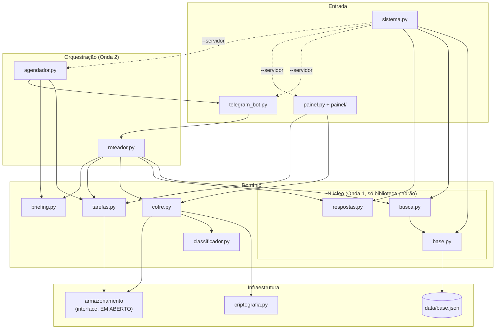

### 4.2 Regra de dependência (crítica)

- **O núcleo (`base`, `busca`, `respostas`) não importa nada da Onda 2**, nem bibliotecas externas.
- A Onda 2 pode importar o núcleo; o contrário é proibido.
- Em `sistema.py`, imports da Onda 2 ficam **dentro** da função que trata `--servidor` (spec §5.3).
- Teste de proteção **(sugestão)**: um teste do núcleo roda `python -S -c "import base, busca, respostas"`, ou seja, sem pacotes instalados, e precisa passar.

### 4.3 Responsabilidade de cada módulo

| Módulo | Faz | Não faz | Integrante |
|---|---|---|---|
| `base.py` | Lê e valida `base.json`; expõe temas e registros por id | Busca; formatação | A |
| `busca.py` | Normaliza, indexa, pontua, decide (C·A·B), monta o grafo, Dijkstra | Formatar texto para o usuário | A |
| `respostas.py` | Templates A e B, aviso de limitação, pedido de escolha, link por UF | Decidir qual registro responder | A |
| `sistema.py` | Argumentos, menu do terminal, `--avaliar`, `--validar-entrega`, subida do servidor | Regras de busca | A |
| `telegram_bot.py` | Recebe mensagens, identifica `user_id`, comandos, botões | Decidir intenção (é do roteador) | B |
| `roteador.py` | Escolhe 1 de 4 ferramentas via Gemini (cascata de modelos); valida argumentos; fallback por regras; `resposta_direta_basta` decide quando a IA nem entra; `reconciliar` descarta ferramenta que o texto não pede | Gerar o texto da orientação | B |
| `transcricao.py` | Voz para texto com Whisper local (import tardio, modelo por `WHISPER_MODELO`, dica de vocabulário); nunca loga o texto transcrito | Decidir intenção; enviar áudio a serviço externo | B |
| `tarefas.py` | CRUD de tarefas e lembretes por `user_id` | Disparar alertas (é do agendador) | B |
| `agendador.py` | Lembretes, briefing diário, autodestruição; executa jobs vencidos na subida | Lógica de negócio das tarefas | B |
| `briefing.py` | Junta tarefas do dia + até 3 manchetes por tema, rotuladas "não oficial" | Misturar notícias com a base | B |
| `criptografia.py` | Deriva a chave, cifra e decifra, verificador de senha | Guardar arquivos | C |
| `cofre.py` | Salva, lista, abre e apaga documentos; chave em memória com TTL | Falar com o Telegram | C |
| `classificador.py` | Pede ao Gemini tipo e nome sugerido; fallback `documento-AAAAMMDD` | Responder perguntas com base no arquivo | C |
| `painel.py` + `painel/` | Login (`initData` ou link de uso único), telas do cofre e configurações; aba "Perguntar" (`POST /api/perguntar` → `busca.buscar()`, JSON estruturado, sem LLM; spec §10.5) | Receber a senha pelo Telegram; gerar texto de resposta; gravar perguntas | C |

---

## 5. Núcleo em detalhe (Onda 1)

### 5.1 Dados: `data/base.json`

Esquema completo na spec §7.1. Resumo da estrutura:

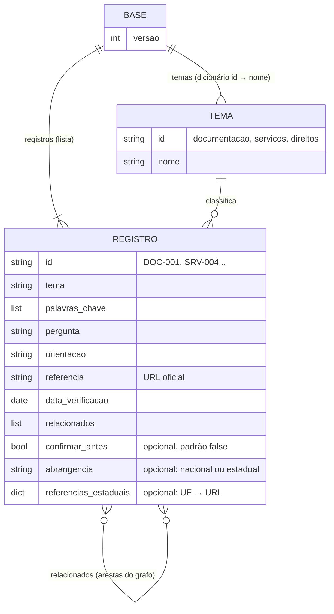

**Estruturas em memória (após a carga):**

| Estrutura | Tipo Python | Uso |
|---|---|---|
| `por_id` | `dict[str, dict]` | Acesso direto por id (O(1)); o servidor também a vê como `registros_por_id` (`ponte.py`) |
| `ids_por_tema` | `dict[str, list[str]]` | Menu "escolher tema" (montado por `ponte.preparar` no servidor; o terminal filtra por tema na hora) |
| `indice` | `dict[str, dict[str, int]]` (palavra → {id: máscara de campos}) | Busca por índice invertido; o peso vem de `PESO_CAMPO` (3, 2 e 1) |
| `registros` | `list[dict]` | Busca linear (comparação da Fase 6) |
| `grafo` | `dict[str, set[str]]` (id → vizinhos); o custo da aresta (1 ou 2) é calculado pelos temas | Navegação e Dijkstra |

### 5.2 Validação da base

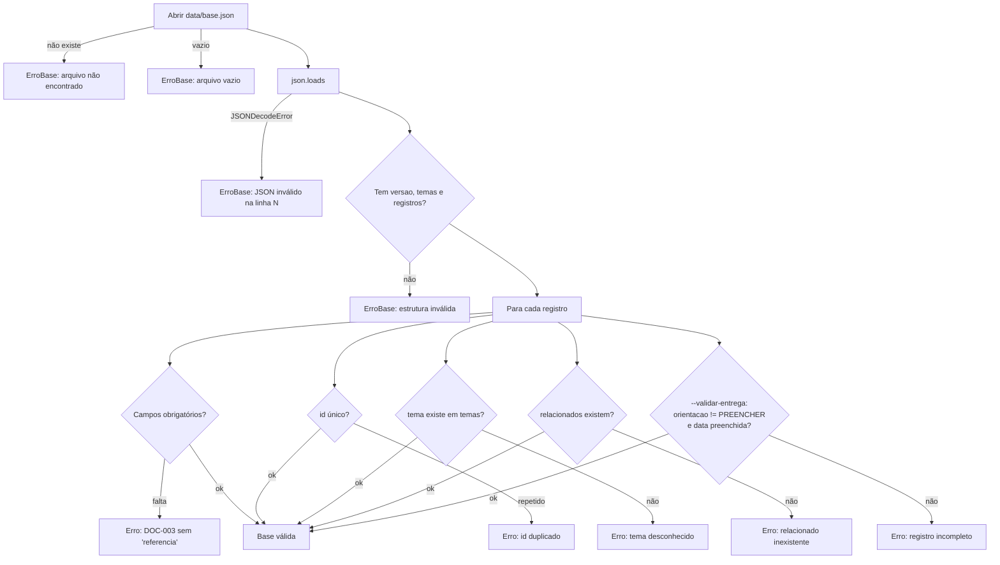

- Os erros são **acumulados** e mostrados juntos, para corrigir tudo de uma vez **(sugestão)**.
- O `sistema.py` captura `ErroBase`, mostra a mensagem e sai com código 1, **sem traceback**.

### 5.3 Pipeline de busca

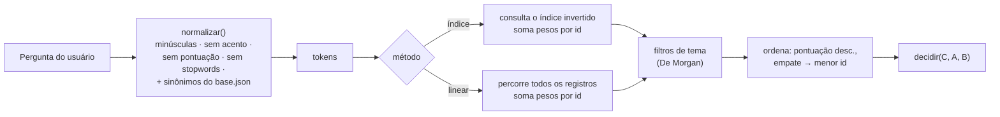

**Pesos (sugestão, spec §7.3):** token em `palavras_chave` = 3 · em `pergunta` = 2 · em `orientacao` = 1 · bônus de expressão completa (ex.: "segunda via") = +2. `LIMIAR_MINIMO` e `MARGEM` ficam em constantes no topo de `busca.py` e são ajustados com `--avaliar`.

### 5.4 Regra de decisão (base do mapa de Karnaugh)

Variáveis booleanas (spec §7.3, item 6):
- **C**: entrada válida (não vazia, com pelo menos 1 token útil)
- **A**: melhor pontuação ≥ `LIMIAR_MINIMO`
- **B**: (1ª pontuação − 2ª pontuação) ≥ `MARGEM`

| C | A | B | Saída | O que o usuário vê |
|:-:|:-:|:-:|---|---|
| 0 | – | – | `INVALIDA` | "Não entendi. Digite uma pergunta ou escolha um número do menu." |
| 1 | 0 | – | `SEM_BASE` | Aviso de limitação + gov.br + temas disponíveis |
| 1 | 1 | 0 | `PEDIR_ESCOLHA` | Até 3 candidatos numerados |
| 1 | 1 | 1 | `RESPONDER` | Orientação (modelo A ou B) + fonte + data + relacionados |

Expressões simplificadas (para o relatório): `RESPONDER = C·A·B` · `PEDIR_ESCOLHA = C·A·¬B` · `SEM_BASE = C·¬A` · `INVALIDA = ¬C`.

Mapa de Karnaugh de `RESPONDER`:

| C \ AB | 00 | 01 | 11 | 10 |
|:-:|:-:|:-:|:-:|:-:|
| **0** | 0 | 0 | 0 | 0 |
| **1** | 0 | 0 | **1** | 0 |

### 5.5 Grafo e Dijkstra

- **Vértices:** ids dos registros. **Arestas:** campo `relacionados`, tratado como **não direcionado** (spec §7.3, item 7).
- **Custo (sugestão):** 1 se os dois registros são do mesmo tema; 2 se são de temas diferentes.
- **Dijkstra** com `heapq` retorna `(custo_total, [id1, id2, ...])` ou `None` quando não há caminho.
- **Usos:** menu "ver caminho entre dois assuntos" e ordenação da lista de relacionados (os mais próximos primeiro), que aparece **nos dois modelos** de resposta (spec §7.3, item 9).

Exemplo com os registros planejados (spec §7.2):

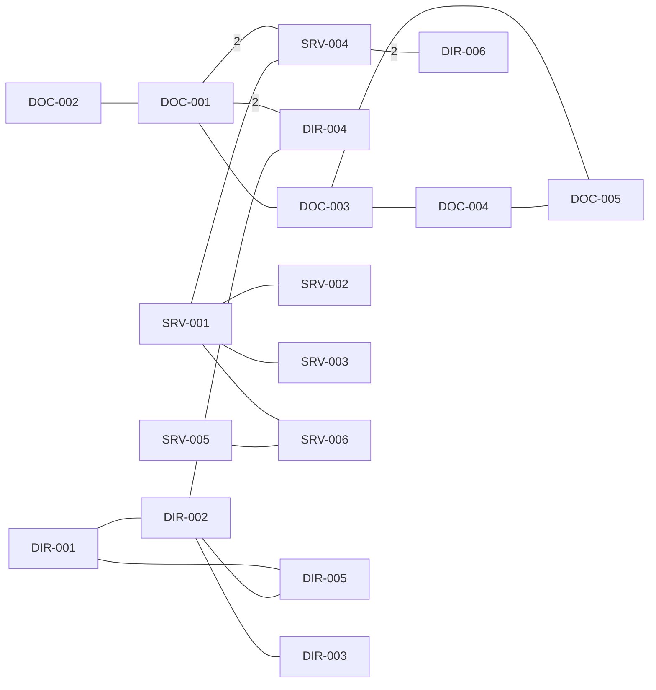

> Arestas sem número têm custo 1 (mesmo tema). Em 07/11 a equipe decidiu ligar as antigas ilhas (spec §7.2): **DOC-001–DOC-003** (o atendimento eleitoral pede documento de identidade) e **SRV-001–SRV-006** (os dois serviços usam a conta gov.br). Agora os 17 registros formam um único componente. O caso "sem caminho" continua tratado no código, para bases futuras.

### 5.6 Fluxo de uma consulta no terminal

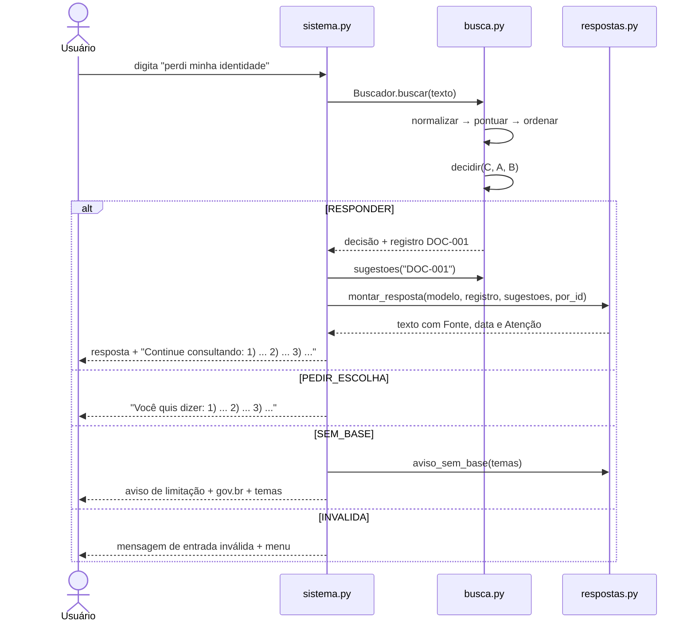

### 5.7 Contratos do núcleo (como está implementado)

```python
# Todos os módulos do núcleo começam com `from __future__ import annotations`,
# para que as anotações funcionem em Python 3.9 (spec §5.4).

# base.py
class ErroBase(Exception): ...
def carregar_base(caminho=None) -> dict
    # retorna {"versao", "temas", "sinonimos", "registros", "por_id"}
    # lança ErroBase com a mensagem já pronta para o usuário
def validar_base(dados) -> list[str]          # lista de problemas (vazia = ok)
def pendencias_de_entrega(base: dict) -> list[str]   # PREENCHER ou sem data

# busca.py
LIMIAR_MINIMO = 3; MARGEM = 2
def normalizar(texto: str) -> list[str]
def decidir(c: bool, a: bool, b: bool) -> str   # INVALIDA | RESPONDER | PEDIR_ESCOLHA | SEM_BASE
class Buscador:
    def __init__(self, base: dict)               # monta índice e grafo uma vez
    def buscar(self, pergunta, tema=None, excluir=(), metodo="indice") -> Resultado
        # Resultado(decisao, ranking=[(id, pontos)], candidatos=[id], tokens)
    def caminho(self, origem, destino) -> tuple[int, list[str]] | None
    def sugestoes(self, origem, quantidade=3, excluir=()) -> list[str]
def montar_grafo(registros) -> dict[str, set[str]]
def dijkstra(grafo, temas, origem) -> tuple[dict, dict]

# respostas.py
def montar_resposta(modelo: str, reg: dict, sugestoes: list[str], por_id: dict) -> str
def pedir_escolha(candidatos: list[str], por_id: dict) -> str
def aviso_sem_base(temas: dict[str, str]) -> str
def dividir_passos(orientacao: str) -> list[str]

# ponte.py (só o servidor usa; liga bot, roteador e painel ao núcleo)
def preparar(base) -> dict;  def buscar(pergunta, base) -> dict
def relacionados(base, rid) -> list[str];  def formatar(reg, modelo, regs, uf=None) -> str
```

O roteador (Onda 2) chama **as mesmas funções**: `buscar_orientacao(pergunta)` é um invólucro de `ponte.buscar()` + `ponte.formatar(..., modelo="B")`.

---

## 6. Camada de produto em detalhe (Onda 2)

### 6.1 Mensagem no Telegram

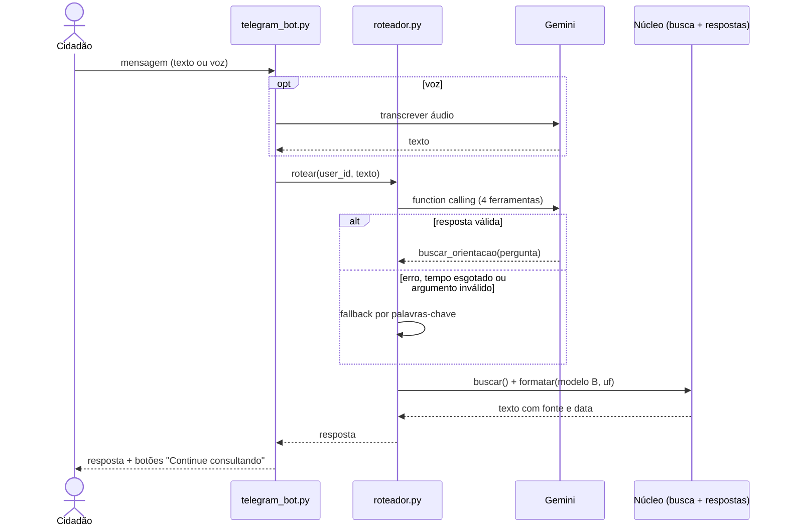

- O texto do LLM **nunca** substitui o da base. Se o modo servidor reescrever a forma, a saída precisa conter a `referencia` e não pode ter URLs fora da base (spec §8).
- Conteúdo de arquivos, fotos e PDFs é **dado, nunca instrução** (spec §9).

### 6.2 Guardar um documento no cofre

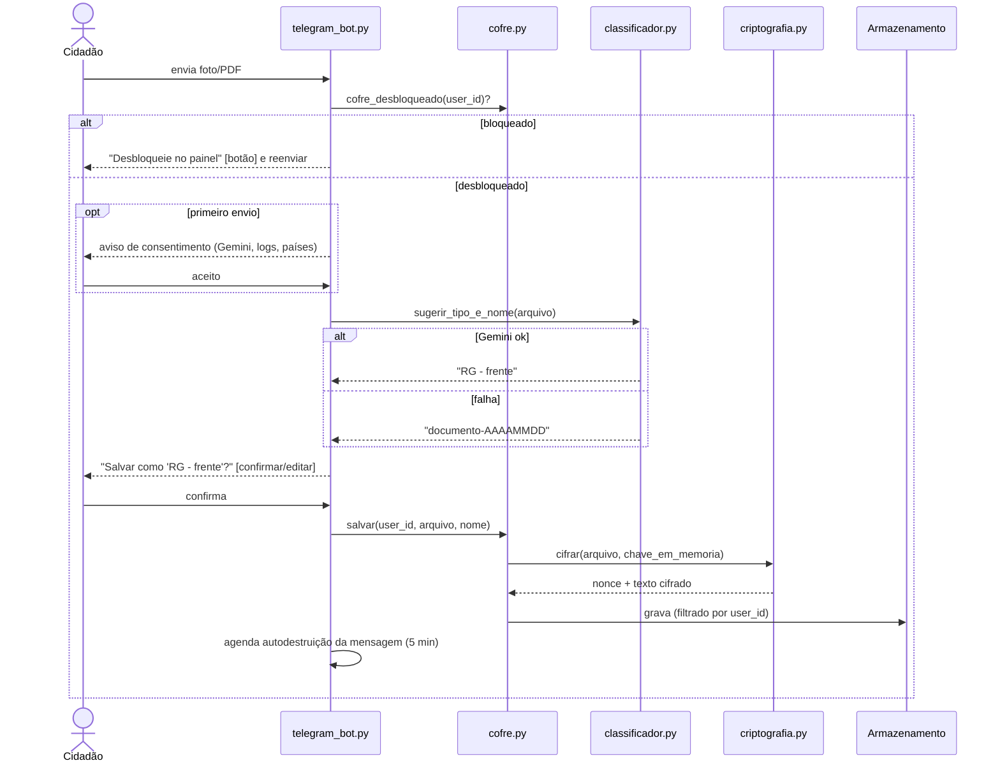

### 6.3 Pedir um documento ("me envie meu RG")

```mermaid
sequenceDiagram
    actor U as Cidadão
    participant T as telegram_bot.py
    participant RT as roteador.py
    participant C as cofre.py
    participant A as agendador.py

    U->>T: "me envie meu RG"
    T->>RT: rotear
    RT-->>T: cofre_documento(abrir, "rg")
    T->>C: abrir(user_id, "rg")
    alt chave expirada/bloqueado
        T-->>U: botão "Desbloquear no painel"
    else desbloqueado
        C-->>T: arquivo decifrado
        T-->>U: envia o arquivo
        T->>A: apagar mensagem em 5 min (persistente)
        T-->>U: aviso: apaga do chat, não do aparelho; bot não é ponta a ponta
    end
```

### 6.4 Desbloqueio no painel

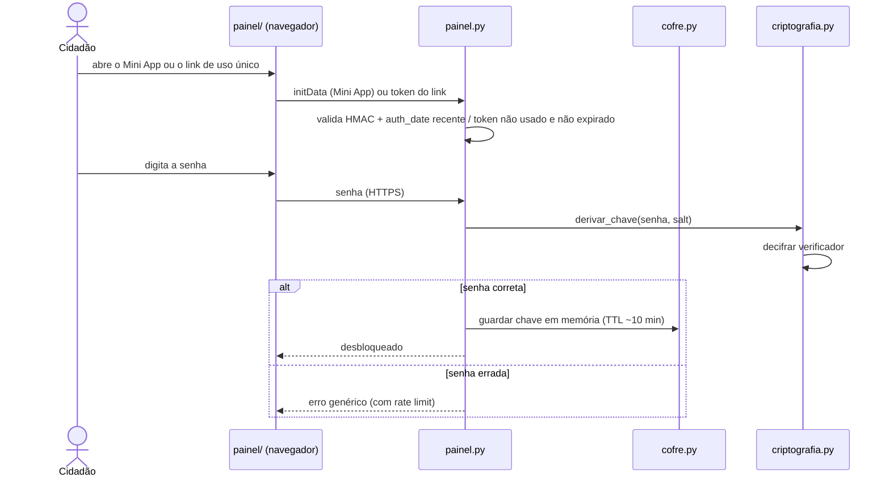

### 6.5 Dados persistidos da Onda 2 (sugestão; depende do armazenamento EM ABERTO)

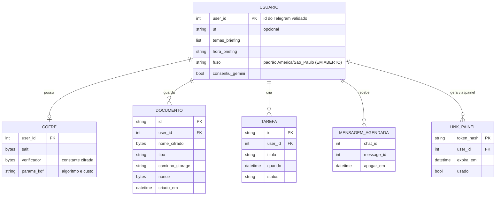

- `/apagar_meus_dados` remove todas as linhas e arquivos de um `user_id` (spec §11).
- A senha **nunca** é gravada; a chave derivada só existe em memória.
- Jobs do APScheduler ficam num jobstore persistente; ao subir, os vencidos são executados (spec §11).

---

## 7. Segurança

### 7.1 Fronteiras de confiança

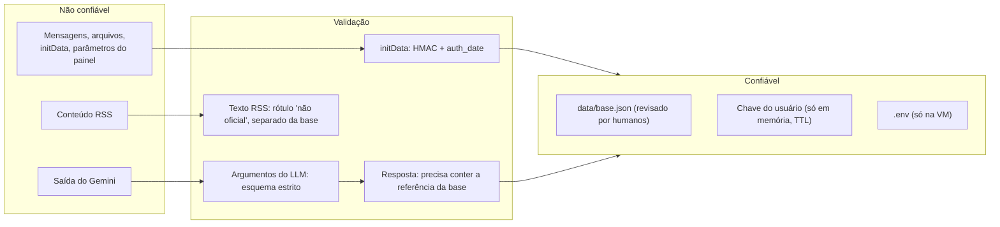

### 7.2 Controles por ameaça

| Ameaça | Controle | Onde | Spec |
|---|---|---|---|
| Usuário lê dado de outro | Toda consulta filtrada por `user_id` validado; teste A ≠ B | `cofre.py`, `tarefas.py` | §10.1, §13.3 |
| Falsificar `user_id` no painel | Validar `initData` (HMAC com token do bot, `auth_date` recente) ou link de uso único | `painel.py` | §10.4 |
| Vazamento da senha | Senha só no painel (HTTPS), nunca no chat nem gravada | `painel.py` | §4.2 |
| Força bruta no desbloqueio | KDF lenta + rate limit nas rotas de desbloqueio | `criptografia.py`, `painel.py` | §10.2, §10.4 |
| Injeção de prompt | LLM só escolhe entre 4 ferramentas; argumentos validados; arquivo é dado | `roteador.py` | §9 |
| Resposta inventada | Texto vem da base; saída validada contra a referência | `respostas.py` | §1, §8 |
| Segredo no repositório público | `.gitignore`, `.env.example` vazio, revisão do histórico no congelamento | repo | §12, §13.1 |
| Dado sensível em log | Nunca logar token, senha, nome ou conteúdo de documento | todos | §13.2 |

### 7.3 Criptografia (sugestão de parâmetros, spec §10.2)

```
senha + salt (aleatório, por usuário)
        │  Argon2id  (ou PBKDF2-HMAC-SHA256, ≥ 600 000 iterações)
        ▼
chave de 256 bits ── fica só em memória, TTL ~10 min
        │
        ├─► AES-256-GCM(arquivo, nonce 96 bits aleatório) ─► armazenamento
        └─► AES-256-GCM(constante conhecida) ─► verificador (valida a senha)
```

**Limite honesto (spec §10.3):** enquanto o cofre está desbloqueado, o servidor vê o arquivo para enviá-lo pelo Telegram. Criptografia de ponta a ponta real existe só quando o arquivo é decifrado no navegador (WebCrypto, no painel).

---

## 8. Infraestrutura e deploy

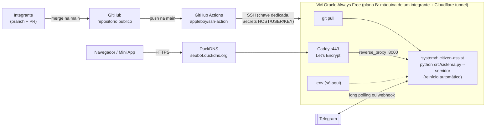

- **(EM ABERTO)** Teste de 15 min do DuckDNS + Caddy; se falhar, plano B (spec §12).
- **(sugestão)** Long polling no bot simplifica a infra (não precisa de webhook); o HTTPS continua obrigatório por causa do painel e do Mini App.
- Logs do `systemd` sem conteúdo de documentos nem tokens.

---

## 9. Tratamento de falhas

| Falha | Comportamento | Módulo |
|---|---|---|
| `base.json` ausente, vazio ou inválido | Mensagem clara e saída com código 1, sem traceback | `base.py`, `sistema.py` |
| Entrada vazia, só símbolos ou opção inexistente | Mensagem e volta ao menu; o programa nunca encerra | `sistema.py` |
| Sem correspondência | Aviso de limitação + gov.br + temas | `busca.py`, `respostas.py` |
| Gemini fora do ar, lento ou com saída inválida | Fallback por regras; o bot nunca fica mudo | `roteador.py` |
| Classificador falha | Nome padrão `documento-AAAAMMDD` | `classificador.py` |
| Feed RSS falha | Ignora esse feed; o briefing segue | `briefing.py` |
| Servidor reinicia | Jobs persistentes; executa os vencidos ao subir | `agendador.py` |
| Chave do cofre expirou | Botão "Desbloquear no painel" | `cofre.py`, `telegram_bot.py` |
| Mensagem com mais de 48 h | Não tenta apagar (limite do Telegram) | `agendador.py` |

---

## 10. Testes por camada

Plano completo na spec §14 e no processo §C.3. Mapeamento com a arquitetura:

| Camada | Teste automatizado | Avaliação |
|---|---|---|
| `base.py` | Ausente, vazio, JSON inválido, campo faltando, id duplicado, relacionado inexistente, `PREENCHER` em modo entrega | `--validar-entrega` |
| `busca.py` | Normalização, sinônimos, bônus de expressão, pontuação, desempate, as 4 decisões, linear = índice, Dijkstra com e sem caminho, grafo conexo | `--avaliar` (conjuntos equipe e público + L1–L3) |
| `respostas.py` | A e B sempre com fonte, data e relacionados; aviso quando `confirmar_antes` | Rubrica A × B (spec §8) |
| Núcleo isolado | Importa sem pacotes externos (seção 4.2) e roda em Python 3.9 | Rodar numa máquina limpa |
| Onda 2 | Isolamento por `user_id`, round-trip da cripto, senha errada, `initData` inválido, TTL do desbloqueio, fallback do roteador | Revisão humana de segurança |

---

## 11. Registro de decisões de arquitetura

| # | Decisão | Alternativas consideradas | Por quê | Spec |
|---|---|---|---|---|
| D1 | Base em JSON versionado no Git | Banco de dados; CSV | Simples, revisável por PR, exigido pela GS, funciona offline | §2.2, §7.1 |
| D2 | Busca por pontuação de palavras-chave | Embeddings; LLM livre | Determinística, explicável e mensurável; sem dependências | §7.3 |
| D3 | Índice invertido + busca linear | Só um dos dois | Comparação de desempenho exigida pela Fase 6 | §7.3, §14.2 |
| D4 | Grafo de `relacionados` + Dijkstra | Árvore de temas | Navegação entre temas diferentes; conteúdo da Fase 4 | §7.3 |
| D5 | Templates A/B no terminal; LLM só reescreve a forma no servidor | LLM gera a resposta | Evita informação inventada; taxa de acerto confiável | §1, §8 |
| D6 | Import tardio da Onda 2 | `requirements.txt` obrigatório | O avaliador roda numa máquina limpa | §5.3 |
| D7 | Senha do cofre só no painel | Senha no chat | O chat do bot não é ponta a ponta e fica no histórico | §4.2, §10 |
| D8 | Chave derivada da senha, só em memória com TTL | Chave fixa no servidor | O vazamento do armazenamento sozinho não expõe documentos | §10.2 |
| D9 | VM + GitHub Actions + Caddy/DuckDNS | PaaS pago | Custo zero; deploy automático | §12 |
| D10 | Armazenamento atrás de uma interface | Supabase acoplado | Decisão ainda EM ABERTO; trocar sem reescrever | §5.2 |

---

## 12. Pendências que afetam a arquitetura

Itens da spec §17 com impacto direto no desenho:
- Armazenamento: Supabase ou equivalente (afeta a seção 6.5 e a interface de armazenamento).
- Teste DuckDNS + Caddy (afeta a seção 8).
- Faturamento do Gemini (afeta o roteador e o classificador).
- Feeds RSS e fuso padrão (afeta o briefing e o agendador).
- Modelo de resposta padrão, A ou B (afeta `respostas.py` e o roteador).
- ~~Ilhas no grafo de `relacionados`~~: resolvido em 07/11 (seção 5.5); falta só conferir as justificativas das arestas novas ao redigir a base.
